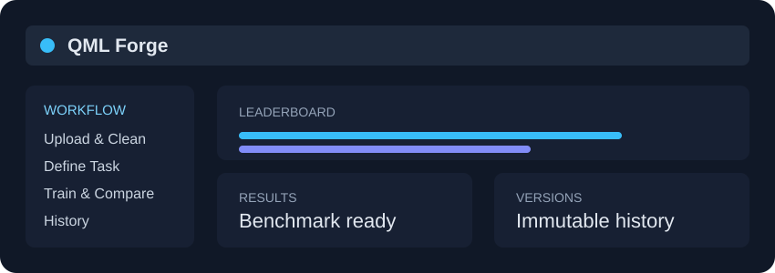
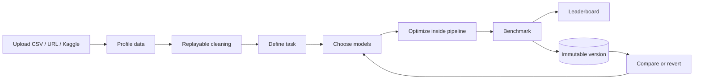

# QML Forge

> **A reproducible Streamlit workbench for cleaning tabular data, benchmarking ML models, and
> comparing classical pipelines with optional simulated quantum models.**

[](https://github.com/Talha-Munir-Saeed3/QML-Forge/actions/workflows/ci.yml)
[](https://www.python.org/)
[](https://streamlit.io/)
[](./LICENSE)

**Author:** Talha Munir Saeed

<p align="center">
  
</p>

## What you can do

| | Workflow | What happens |
|---|---|---|
| 📥 | **Ingest** | Upload a CSV, load a direct public CSV URL, or import a selectable CSV from Kaggle. |
| 🧹 | **Clean** | Apply replayable operations for missing values, duplicates, types, outliers, and encoding. |
| 🎯 | **Define** | Choose classification, regression, or clustering and select a target where applicable. |
| ⚙️ | **Optimize** | Configure scaling, feature selection, PCA, and grid/random search. |
| 🏁 | **Benchmark** | Compare selected classical models and optional simulated quantum models. |
| 🕘 | **Version** | Save immutable runs, inspect history, compare results, and create child versions by reverting. |

## Interactive workflow



<details>
<summary><strong>Open the page-by-page tour</strong></summary>

### Upload & Clean

Use the **Upload & Clean** page to:

- Upload local CSV files up to 50 MB
- Load direct public CSV URLs
- Import Kaggle datasets through the Kaggle API
- Select one CSV when a Kaggle dataset contains multiple CSV files
- Preview the data and column profile
- Apply, undo, and inspect cleaning steps

### Define Task

Choose one of:

- Classification
- Regression
- Clustering

For supervised tasks, select the target column. QML Forge then builds the feature matrix and
reports quantum-readiness notes.

### Train & Compare

Select models manually or use **Recommended**. Configure:

- Classical and quantum model selection
- Simulated quantum row cap and qubit count
- Cross-validation folds
- Scaling
- PCA
- Grid or random hyperparameter search
- Classical comparison on the same quantum sample

### History

Every benchmark configuration is stored as an immutable version. You can:

- View settings and results
- Edit labels and notes
- Compare two versions
- Revert to an older configuration
- Delete a dataset and its dependent versions

</details>

## Quick start

### Windows PowerShell

```powershell
git clone https://github.com/Talha-Munir-Saeed3/QML-Forge.git
cd QML-Forge

py -3.13 -m venv .venv
.\.venv\Scripts\Activate.ps1
python -m pip install --upgrade pip
python -m pip install -r requirements.txt
python -m streamlit run app.py
```

Open [http://localhost:8501](http://localhost:8501).

If PowerShell blocks activation:

```powershell
Set-ExecutionPolicy -Scope Process -ExecutionPolicy Bypass
.\.venv\Scripts\Activate.ps1
```

### Run the tests

```powershell
python -m pytest -q
```

## Configuration

Copy [.env.example](./.env.example) to `.env`. The `.env` file is ignored by git.

```env
QMLFORGE_DB_URL=sqlite:///data/qmlforge.db
```

SQLite is the default. A PostgreSQL connection string can be supplied through
`QMLFORGE_DB_URL`.

### Kaggle imports

To load Kaggle dataset pages, configure either a Kaggle API token:

```env
KAGGLE_API_TOKEN=your_token
```

or the legacy credentials:

```env
KAGGLE_USERNAME=your_username
KAGGLE_KEY=your_api_key
```

Never commit `.env` or credentials. Kaggle datasets are downloaded through the API, and the user
selects which CSV to load when a dataset contains multiple CSV files.

## Data and safety limits

- Local and remote CSVs are limited to **50 MB**
- CSV encoding supports UTF-8 with Latin-1 fallback
- Delimiters are detected for comma, semicolon, tab, and pipe-separated files
- Private/local URL hosts are rejected
- Uploaded files are stored by SHA-256 content hash
- Uploaded files are treated as CSV data; QML Forge never unpickles uploads
- Quantum models are **off by default**
- Quantum models run on a classical simulator
- Quantum runs are capped at 300 sampled rows and 8 qubits

The 50 MB limit prevents Streamlit and pandas from holding oversized files and their intermediate
copies in memory. Large-file streaming and sample-based processing can be added as a separate
ingestion mode.

## Project documentation

<table>
  <tr>
    <td><a href="./docs/DESCRIPTION.md">📘 Description</a></td>
    <td>Product overview and capabilities</td>
  </tr>
  <tr>
    <td><a href="./docs/FILE_STRUCTURE.md">🗂️ File structure</a></td>
    <td>Complete project file map</td>
  </tr>
  <tr>
    <td><a href="./docs/USER_FLOW.md">🧭 User flow</a></td>
    <td>Step-by-step application flow</td>
  </tr>
  <tr>
    <td><a href="./docs/ARCHITECTURE.md">🏗️ Architecture</a></td>
    <td>Layers, data flow, and design decisions</td>
  </tr>
  <tr>
    <td><a href="./docs/DATABASE.md">🗄️ Database</a></td>
    <td>Schema and immutable version semantics</td>
  </tr>
  <tr>
    <td><a href="./docs/REQUIREMENTS.md">✅ Requirements</a></td>
    <td>Functional and non-functional requirements</td>
  </tr>
  <tr>
    <td><a href="./docs/ROADMAP.md">🛣️ Roadmap</a></td>
    <td>Planned delivery phases</td>
  </tr>
</table>

## Development

Business logic belongs in [core/](./core/). Streamlit screens belong in
[pages/](./pages/). See [CONTRIBUTING.md](./CONTRIBUTING.md) for the development workflow.

```text
app.py                  Home page
pages/Upload_Clean.py   Ingestion, profiling, and cleaning
pages/Define_Task.py    Task and target selection
pages/Train_Compare.py  Model configuration and benchmarking
pages/History.py        Version management
core/                   Reusable business logic and persistence
tests/                  Automated tests
```

## Honest quantum note

Quantum models in QML Forge run on a classical simulator. The project makes no claim of quantum
advantage. It provides a reproducible way to compare simulated quantum models with classical
baselines on the same prepared data.
