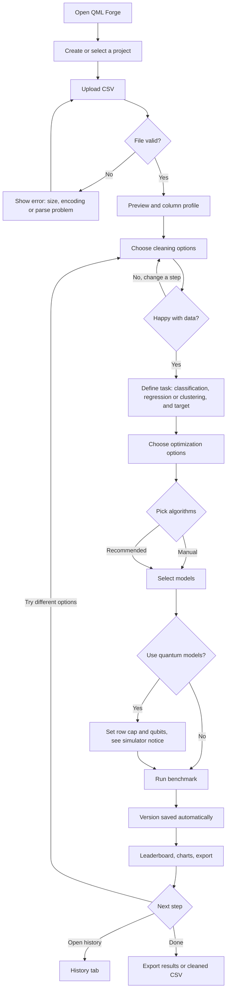
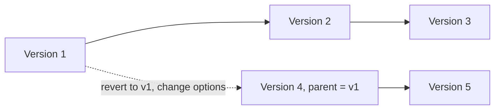
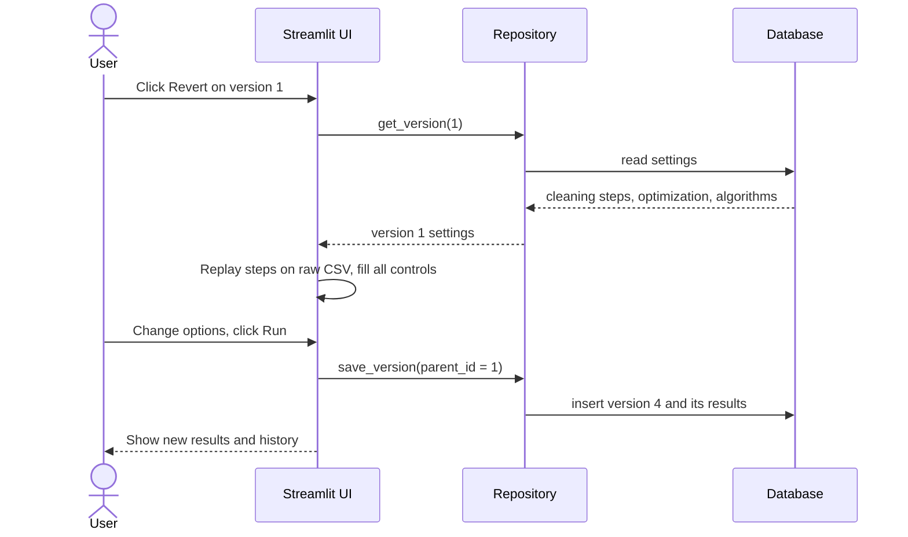
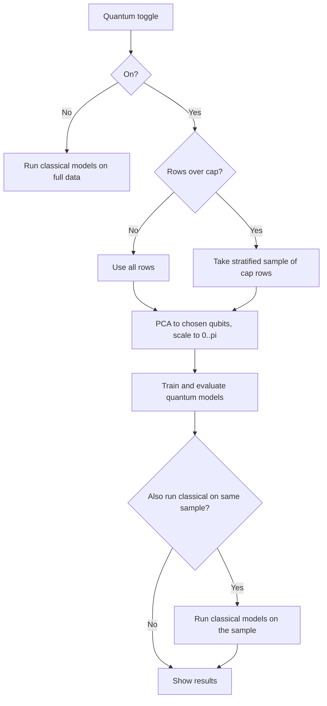

# QML Forge: User Flow

| | |
|---|---|
| **Author** | Talha Munir Saeed |
| **Status** | Draft for review |
| **Related docs** | [PRD.md](PRD.md), [REQUIREMENTS.md](REQUIREMENTS.md) |

The diagrams use Mermaid, which GitHub renders automatically.

---

## 1. Main flow

## 2. Screens and what happens on each

### Screen 1: Project and upload
1. User creates a project or picks an existing one in the sidebar.
2. User uploads a CSV.
3. The app checks extension, size (50 MB max), encoding, and delimiter.
4. The app shows a preview (first 100 rows) and a column profile: type, missing %, unique count.
5. If the same file (same hash) was uploaded before, the app warns and offers to reuse it.

### Screen 2: Clean
1. User chooses an operation (standardize names, trim whitespace, fix casing, drop duplicates or columns, convert to number or date, impute, drop missing rows, clip outliers, encode).
2. User sets its options (columns, strategy) and clicks **Apply**.
3. The table and profile refresh; the step is added to the **audit log**.
4. **Undo last** removes the most recent step by replaying the log without it.
5. User can download the cleaned CSV and the cleaning log.

### Screen 3: Define task
1. User picks classification, regression, or clustering.
2. For classification and regression, user picks the target column.
3. The app shows the feature matrix size and **quantum readiness** notes (suggested qubits, row cap warning).

### Screen 4: Optimize and choose algorithms
1. User chooses scaling, feature selection, PCA components, and hyperparameter search (none, grid, random).
2. User selects algorithms manually, or clicks **Use recommended** to fill the list with short reasons.
3. User sets cross-validation folds and the random seed.
4. Quantum panel (collapsed, **off by default**):
   - Checkbox: use quantum models.
   - Sliders: qubits (2 to 8) and row cap (default 100, max 300).
   - Checkbox: also run classical models on the same sample.
   - Notice: "Quantum models are simulated on a classical computer."

### Screen 5: Results
1. User clicks **Run benchmark**; a progress bar shows each model.
2. The app saves a new **version** and the run results to the database.
3. The leaderboard lists models with metrics, training time, model type, and rows used.
4. Charts: metric bar chart, confusion matrix, feature importance (where available).
5. Optional experiment: **qubit sweep** (accuracy vs number of qubits).
6. User can export results as CSV or JSON.

### Screen 6: History (versions)
1. A table lists versions: number, label, parent, date, best metric.
2. Opening a version shows its full settings and results.
3. User can edit the label and notes.
4. **Compare**: choose two versions to see a settings diff and a side-by-side metric table.
5. **Revert**: loads that version's cleaning steps, optimization settings, and algorithms back into the app.
6. **Delete dataset** (with confirmation) removes its versions and the stored file.

## 3. Revert and branching flow

- Versions are never edited. Reverting to version 1 does **not** delete versions 2 and 3.
- The next run after a revert becomes a new version (here version 4) whose parent is version 1.
- History therefore forms a tree, and the user can always return to any earlier point.

## 4. Quantum toggle flow

## 5. Edge cases and messages

| Situation | What the user sees |
|-----------|--------------------|
| File over 50 MB or not a CSV | Error message with the limit; upload is rejected |
| Wrong encoding | The app tries UTF-8, then Latin-1; if both fail, a clear message |
| Target column has one class or too few rows | Run is blocked with an explanation |
| Missing values left in features | Imputed automatically inside the pipeline; the user is told |
| More features than qubits | PCA reduces features; a note warns that variance is lost |
| Rows exceed the quantum cap | Sample notice showing the number of rows used |
| VQC with more than two classes | Message that VQC is binary; suggests Quantum Kernel SVM |
| A model fails | Its row shows the error; other models still run |
| Revert while settings are unsaved | Confirmation: "Replace current settings?" |
| Delete dataset | Confirmation listing how many versions will be removed |

## 6. Navigation summary

| Tab | Purpose | Main actions |
|-----|---------|--------------|
| 1. Clean data | Upload and clean | Upload, apply, undo, download |
| 2. Define task | Task and target | Choose task, target, see readiness |
| 3. Train and compare | Optimize, select, run | Choose models, quantum toggle, run, export |
| 4. History | Versions | Open, compare, revert, label, delete |
